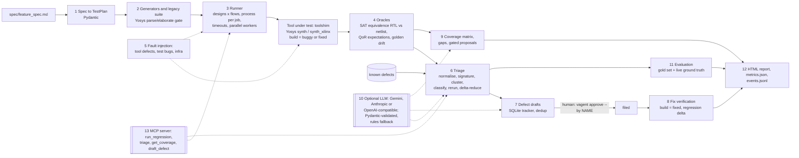

# Agentic verification of an FPGA synthesis toolchain (PoC)

A working proof of concept of an agent that runs the verification lifecycle of an **FPGA synthesis
tool**: spec analysis, test planning and generation, regression execution, formal and QoR oracles,
failure triage with minimal reproducers, defect drafting with human approval, fix verification,
coverage gap analysis and evaluation of its own triage accuracy.

The tool under test is **Yosys** (`synth` and `synth_xilinx`, which targets AMD/Xilinx 7-series
devices), used as an **open-source analogue** of a commercial FPGA synthesis tool. This project does
not use, wrap or claim anything about Vivado or Vitis. Yosys runs as WebAssembly through the
pip-installable `yowasp-yosys` package, so there is nothing to install besides Python packages.

To have bugs to find, `vagent/toolshim.py` wraps Yosys as two emulated builds: `buggy` injects tool
defects that fire only under specific feature and option combinations (the way real regressions
behave), and `fixed` turns them off. The legacy test suite contains deliberately broken testcases
and the runner injects infrastructure failures. Every injected fault writes a ground-truth label
that triage never reads and evaluation does.

**Why**: this is the shape of work in an AI-for-tool-verification role: an LLM-capable agent is
only useful if deterministic oracles decide pass/fail, outputs are structured and validated, a
human approves anything with impact, and the agent's accuracy is measured on labelled data.

## Architecture



| Path | Purpose |
|---|---|
| `spec/feature_spec.md` | feature spec the agent plans from (flows, features, expectations, priorities) |
| `vagent/spec.py` | stage 1: markdown spec to validated `TestPlan` |
| `vagent/generators.py`, `testsuite/legacy/` | stage 2: parameterised Verilog generators; hand-written legacy tests (three contain test bugs) |
| `vagent/runner.py`, `vagent/worker.py` | stage 3: job matrix, one process per job, timeouts, JSON results |
| `vagent/toolshim.py` | tool under test with emulated `buggy`/`fixed` builds (stage 5 tool defects) |
| `vagent/oracles.py` | stage 4: SAT miter equivalence with Xilinx primitive models, QoR and golden checks |
| `vagent/triage.py` | stage 6: normalisation, signatures, clustering, rules, known-defect match, delta reduction |
| `vagent/tracker.py` | stage 7: SQLite tracker, dedup, approval gate, audit trail |
| `vagent/agent.py` | orchestrator and stage 8 (fix verification); persists run state |
| `vagent/coverage.py` | stage 9: feature x flow matrix, gaps, next-test proposals through the Yosys gate |
| `vagent/llm.py` | stage 10: Gemini / Anthropic / OpenAI-compatible providers, schema validation, fallback |
| `vagent/evaluate.py`, `eval/` | stage 11: metrics, gold set (harvested + handwritten hard cases) |
| `vagent/obs.py`, `vagent/report.py` | stage 12: JSON-lines events, metrics, static HTML report |
| `vagent/mcp_server.py` | stage 13: MCP tools (draft only; no approve tool by design) |
| `golden/qor_golden.json` | golden primitive counts from the `fixed` build (`python -m vagent bless`) |
| `data/known_defects.json` | known-defect database (one open, one closed entry) |

## How to run

Windows (PowerShell); on Linux/macOS use `.venv/bin/python`.

```powershell
python -m venv .venv
.\.venv\Scripts\python.exe -m pip install -r requirements.txt
.\.venv\Scripts\python.exe -m pytest -q
.\.venv\Scripts\python.exe -m vagent demo --approve-as "<your name>" --reset-tracker
```

`demo` runs every stage. Without `--approve-as` it stops after drafting defects and prints the
approval command; that is the intended human-in-the-loop step:

```powershell
.\.venv\Scripts\python.exe -m vagent defects                      # list drafts
.\.venv\Scripts\python.exe -m vagent approve DEF-0001 --by "<your name>"
.\.venv\Scripts\python.exe -m vagent verify-fix                   # re-run on build=fixed, close verified defects
```

Other commands: `demo --profile quick` (smaller matrix, used in CI), `coverage`, `eval`,
`report`, `rerun-job <dir> [--build fixed]` (replay a minimal reproducer), `bless` (regenerate
goldens), `build-gold` (harvest a labelled gold set from the latest run), `mcp` (start the MCP
server on stdio). Outputs go to `runs/<timestamp>-<profile>/`: `report.html`, `metrics.json`,
`events.jsonl`, `clusters.json`, `coverage.json`, `eval.json`, `fixverify.json` and one directory
per job with `design.v`, `synth.ys`, `synth.log`, `netlist.json`, `equiv.ys`, `equiv.log` and
`result.json`.

**Live LLM mode (optional)**: `demo --mode llm` uses the first configured provider:
`GEMINI_API_KEY` (google-genai; `GEMINI_MODEL`, default `gemini-2.5-flash`), `ANTHROPIC_API_KEY`
(`ANTHROPIC_MODEL`, default `claude-haiku-4-5`), or any OpenAI-compatible endpoint via
`LLM_BASE_URL` + `LLM_MODEL` [+ `LLM_API_KEY`], for example NVIDIA's hosted models at
`https://integrate.api.nvidia.com/v1` or a local Ollama server at `http://localhost:11434/v1`.
Force one with `LLM_PROVIDER=gemini|anthropic|openai_compat`. LLM output must validate against a
Pydantic schema; anything else is logged as `llm_fallback` in `events.jsonl` and the rule-based
result is used. In defect drafting the LLM may only rewrite the title and summary: signature,
category, severity, affected tests, repro steps, component and the observed and expected text are
pinned to the deterministic values. HTTP 429 (rate limit) responses are retried after the server's
`Retry-After` delay (`LLM_MAX_RETRIES`, default 8), so a free-tier quota slows a run down instead of
silently falling back to rules. Example with Groq: `LLM_PROVIDER=openai_compat`,
`LLM_BASE_URL=https://api.groq.com/openai/v1`, `LLM_MODEL=openai/gpt-oss-120b`, `LLM_API_KEY=<key>`.

## Results from an actual run

Run `20261123-215943-full`, 23 Nov 2026, Windows 11 laptop (14 logical CPUs), Python 3.14.4,
`yowasp-yosys 0.71.0.0.post1285`, 8 workers, rules mode. The demo ran
without `--approve-as` and stopped at drafts. The approval step was then executed with
`approve --all --by "automated PoC run (build agent, not a human reviewer)"` so that fix
verification could be exercised; the audit trail records that label. In real use a person runs
that command.

**Regression (build=buggy)**: 13 testcases (10 generated and gated, 3 legacy) x 5 flows = 65 jobs
in 207.6 s. 38 passed, 27 failed (pass rate 58.5%, expected because faults were injected).
Equivalence verdicts: 15 full combinational proofs, 27 bounded sequential passes, 6
counterexamples, 4 skipped (block RAM), 13 not run (tool error before a netlist existed).

**Triage** (77.8 s, including 2 infrastructure reruns and delta reduction of 4 clusters):
27 failing jobs became 10 clusters.

| Cluster | Kind | Testcases | Trigger options | Classification (confidence) | Jobs | Defect |
|---|---|---|---|---|---|---|
| C01 | parse_error | tc_legacy_cmp4 | - | test_bug (0.9) | 5 | DEF-0001 |
| C02 | elab_error | tc_legacy_gray | - | test_bug (0.9) | 5 | DEF-0002 |
| C03 | qor_expect | tc_legacy_parity | synth_xilinx | test_bug (0.85) | 4 | DEF-0003 |
| C04 | equiv_fail | tc_macc, tc_mul_reg | -flatten | tool_defect (0.9) | 4 | DEF-0004 |
| C05 | qor_golden | tc_addsub, tc_counter | -flatten | tool_defect (0.9) | 4 | DEF-0005 |
| C06 | infra | tc_shreg | - | infrastructure (0.9) | 1 | - |
| C07 | crash | tc_param_hier | synth | known_issue (0.95) | 1 | KDB-0001 |
| C08 | timeout | tc_counter | - | infrastructure (0.9) | 1 | - |
| C09 | equiv_fail | tc_fsm_seqdet | -dff | tool_defect (0.9) | 1 | DEF-0006 |
| C10 | equiv_fail | tc_lutram | -noiopad | tool_defect (0.9) | 1 | DEF-0007 |

Minimal reproducers from delta reduction: C04 `-flatten` alone (removed `-noiopad`; width
reduction did not reproduce, so W stays 6); C05 `-flatten` alone (removed `-noiopad`; parameter
reduction not possible because reduced designs have no golden); C09 `-dff` (already minimal);
C10 `-noiopad` alone (removed `-flatten`) with the memory shrunk from 16x8 to 4x2.

**Defects**: 7 drafts (4 tool defects, 3 testcase bugs), deduplicated by signature; nothing was
filed until the approve command ran. Infrastructure and known-issue clusters produced no drafts.

**Fix verification (build=fixed)**: 34 jobs re-run in 103.5 s (the 10 failing jobs of the 4 tool
defects, their 4 reproducers, and the other 20 regression jobs of the affected testcases).
Regression delta: fixed 10, still failing 0, new failures 0, still passing 20. All 4 tool defects
closed; the 3 testcase-bug defects stay filed because the testcases themselves were not changed.

**Coverage**: 39 of 57 required feature x flow cells formally verified (68.4%). Gaps: 6 cells
with only failing results (the injected defects), 4 block RAM cells with QoR-only verdicts, 1 cell
failing on the known issue, 2 features with no test (FEAT-ASYNC-RST, FEAT-WIDEMUX), 2 spec flows
not in the regression. Both proposed tests (async-reset counter, 32:1 mux) passed the Yosys gate and
wait for human review in `runs/<run>/proposals/`.

**Triage evaluation (rules mode)**:

| Data | n | Accuracy | tool_defect P/R | test_bug P/R | infrastructure P/R | known_issue P/R |
|---|---|---|---|---|---|---|
| Live run, job level (labels from fault injection) | 27 | 1.000 | 1.00 / 1.00 | 1.00 / 1.00 | 1.00 / 1.00 | 1.00 / 1.00 |
| Gold set (10 harvested + 12 handwritten) | 22 | 0.818 | 0.75 / 0.90 | 0.75 / 0.50 | 1.00 / 1.00 | 1.00 / 1.00 |

On the 12 handwritten hard cases alone the rules score 0.667 (8/12). The four misses: an
uninitialised-register testcase and a hierarchy-probing testcase that the rules call tool defects,
a stale expectation with no golden to compare against, and an option-triggered internal "module not
found" error that the rules call a testcase bug. Zero escapes: every injected tool defect that
fired was flagged by an oracle.

**Wall time**: `demo` 4 min 52 s end to end (stopping at drafts), then `verify-fix` 1 min 46 s.
The `--profile quick` run used in CI (20 jobs, 4 workers) took 1 min 47 s.

**After the review fixes (24 Nov 2026)**: run `20261124-040849-full`, with the drafts approved by
the project owner through `demo --approve-as`, reproduced the same results: 38 of 65 jobs pass, 27 failures in 10 clusters, 7 drafts,
fix verification fixed 10, still failing 0, new failures 0, still passing 20, and 4 of 4 tool
defects closed.

## Results in LLM mode

Run `20261124-012322-full`, 24 Nov 2026, same machine, `demo --mode llm` with
`openai/gpt-oss-120b` on Groq's free tier (8,000 tokens per minute), stopping at drafts. The
regression results are identical to rules mode (the oracles, not the LLM, decide pass or fail).
41 LLM calls returned valid structured output, 0 fell back to rules, and the client waited out 27
rate-limit responses. The LLM stages took 112 s (triage), 41 s (drafting) and 112 s (evaluation).

| Data | n | Rules accuracy | LLM accuracy | tool_defect P/R (LLM) | test_bug P/R (LLM) | infrastructure P/R (LLM) | known_issue P/R (LLM) |
|---|---|---|---|---|---|---|---|
| Live run, job level | 27 | 1.000 | 0.852 | 0.71 / 1.00 | 1.00 / 0.71 | 1.00 / 1.00 | 1.00 / 1.00 |
| Gold set | 22 | 0.818 | 0.727 | 0.67 / 0.80 | 1.00 / 0.33 | 0.67 / 1.00 | 1.00 / 1.00 |

What the LLM got wrong: it labelled cluster C03 (a stale "DSP>=1" expectation in a legacy
testcase, which the rules call a testcase bug) as a tool defect, so its draft DEF-0003 blames the
tool. A reviewer should reject that draft; if it were approved, fix verification would not close it
because the testcase still fails on the fixed build. The LLM also proposed one Verilog test that did
not parse; the Yosys gate rejected it, so 1 of 2 proposals was admitted (2 of 2 in rules mode).
An earlier run of the same model, before the review fixes, scored 0.852 live and 0.682 on the gold
set, so LLM accuracy varies between runs even at temperature 0. On this data the rules are more
accurate than the LLM; the value of the LLM here is readable defect prose and test proposals, both
behind validation and human approval.

**Tests**: `pytest -q` 45 passed: unit tests for spec parsing, flows, fault triggers, triage,
tracker approval gate, LLM validation and fallback, metrics, coverage, MCP tool listing, three tests
that run real Yosys, 14 regression tests for the review fixes below, and 11 checks on the
fine-tuning dataset (schema, labels, no test leakage).

## Fine-tuning an open model for triage (optional)

[`finetune/`](finetune/README.md) fine-tunes `Qwen/Qwen2.5-1.5B-Instruct` (Apache-2.0) with LoRA
to do the triage classification, using 380 examples labelled from fault-injection ground truth
(never from the rules), with near-duplicates of the 22 gold items removed. The notebook runs on a
free Kaggle or Colab T4 GPU and compares the fine-tuned model with the rules and the gpt-oss-120b
runs above on the same gold set. So far it has run end to end only as a CPU smoke test with a 0.5B
model; there are no GPU results yet.

## Review fixes (24 Nov 2026)

A code review found these bugs; each is fixed and most have a regression test
(`tests/test_review_fixes_core.py`, `tests/test_review_fixes_tools.py`):

- A closed defect that fails again is reopened as a draft (with an audit entry) instead of only
  incrementing a counter.
- Fix verification closes nothing when the fixed build introduces new failures, records its stage
  on every path, and a repeated `verify-fix` keeps the earlier evidence instead of overwriting it.
- An equivalence-oracle error now fails the job (kind `infra`) instead of passing silently; SAT
  timeouts are recognised by Yosys's actual message, not by any "TIMEOUT" text in the log.
- Timeouts and infrastructure failures are clustered by their own rerun outcome, so a flaky hang
  and a real hang are no longer merged; flows that passed on rerun count as passing when the
  trigger option is fingerprinted.
- A minimal reproducer must show the same failure message as its cluster; the reduction cache is
  keyed by flow base and family as well as options.
- In LLM mode the model can no longer change a defect's observed or expected text or component.
- Gold labels break ties deterministically; the report shows rules and LLM accuracy side by side.
- MCP: `run_regression` validates the profile before creating a run directory, `get_coverage`
  runs triage first if needed, and MCP-drafted defects are linked so they can be verified.
- `reject` validates the reviewer name and refuses non-draft defects; `rerun-job` clears stale
  results before re-running; JSON and source files are read and written as UTF-8 on Windows; the
  event log is thread-safe; the OpenAI-compatible client sends a User-Agent (Groq rejects Python's
  default) and retries rate-limit responses.

## Capabilities demonstrated

| Capability | Where in this PoC |
|---|---|
| LLM agent and agentic workflow in Python | `vagent/agent.py` orchestrates 12 stages with persisted state; optional LLM reasoning in triage, drafting and test proposals |
| Spec analysis, test planning and generation | `spec.py` (spec to validated plan), `generators.py` (gated generation), `coverage.py` (gap-driven proposals) |
| Execution, failure triage, defect management, fix verification | `runner.py`/`worker.py`, `triage.py` (signatures, clustering, reducer), `tracker.py` (approval gate), `agent.stage_verify_fix` |
| Coverage and regression | feature x flow matrix and gaps; regression delta on the fixed build; golden QoR |
| AI reasoning combined with deterministic automation | formal equivalence and QoR decide pass/fail; rules are the default classifier; the LLM is optional and validated |
| Integration with APIs, CI/CD and databases | MCP server, GitHub Actions workflow, SQLite tracker, JSON artefacts per job |
| Evaluation, reliability, observability | labelled gold set and live ground truth with per-class precision/recall; escape tracking; JSON-lines events; metrics; HTML report |
| Human-in-the-loop validation | `approve --by` is the only path to "filed"; MCP has no approve tool; proposals wait for human review |
| MCP, structured outputs, state management | `mcp_server.py`; Pydantic models for every LLM output; run directory with `state.json` and per-stage artefacts |
| Open-model fine-tuning | `finetune/`: LoRA on Qwen2.5-1.5B-Instruct with leakage-checked data; free T4 notebook |

## Limitations (read before quoting results)

- Yosys stands in for a commercial tool; the defects are injected by a wrapper, not real Yosys bugs.
  The rule classifier was written by the same author as the fault model, so live accuracy on these
  faults is optimistic; the handwritten hard cases in the gold set show where the rules fail.
- Equivalence for sequential designs is bounded (N cycles from reset), not a full proof. Block RAM
  designs are skipped by the formal oracle and get QoR checks only: a miter against Yosys's
  behavioural RAMB18E1/RAMB36E1 model reported a read-first write-collision mismatch that could not
  be attributed to the tool, so that model is not trusted here.
- `sat -timeout` did not interrupt the solver in this WebAssembly build (a 6-bit multiply-accumulate
  checked 4 cycles deep ran past 5 minutes), so SAT-hard checks are avoided by keeping multiplier
  widths and depths small; the per-job timeout is the backstop.
- No place and route, timing or bitstream: synthesis only.
- LLM numbers come from single runs of one hosted model on 49 classified items (27 jobs, 22 gold
  items); they vary between runs and should not be read as a benchmark of the model.
